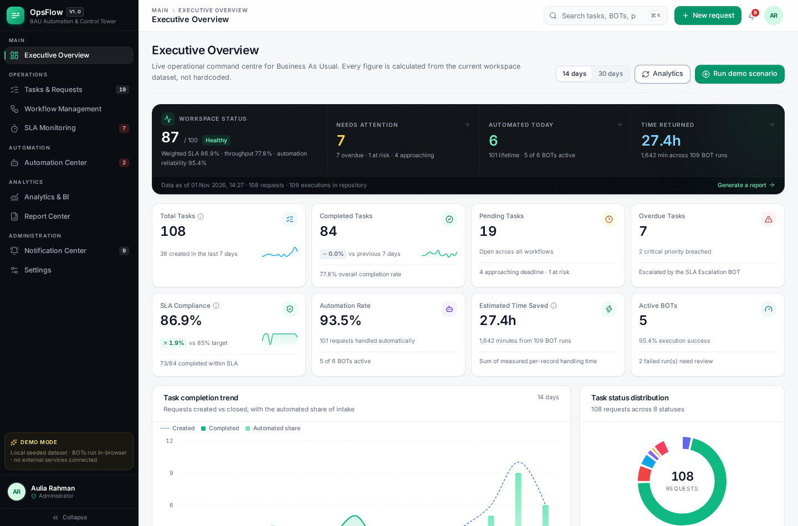
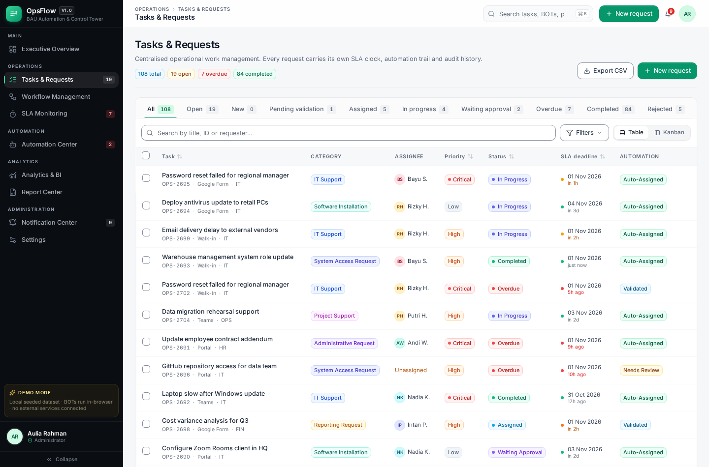
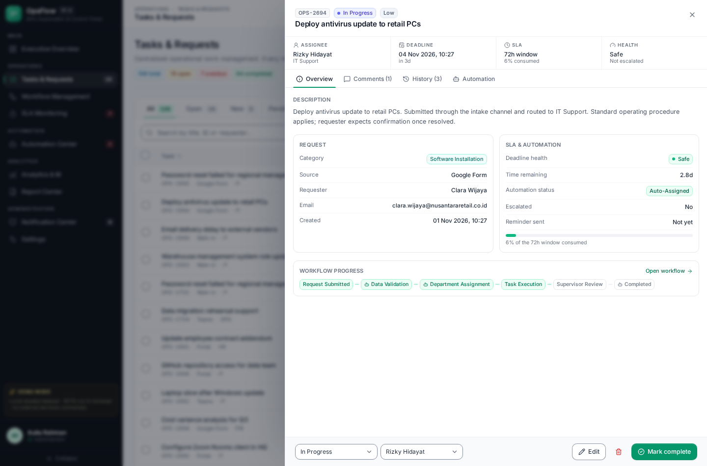
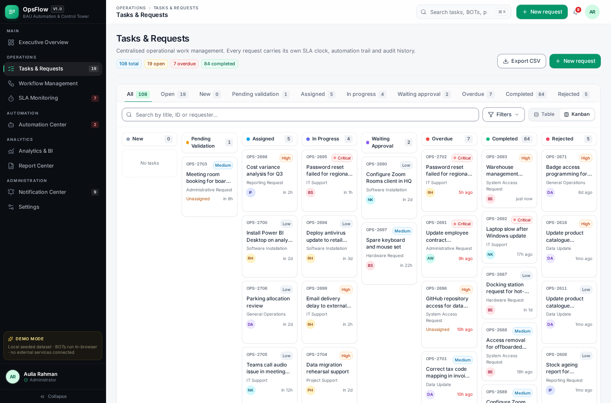
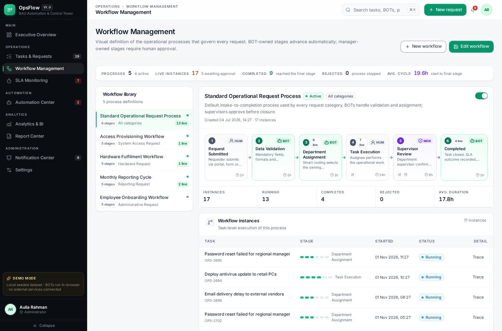
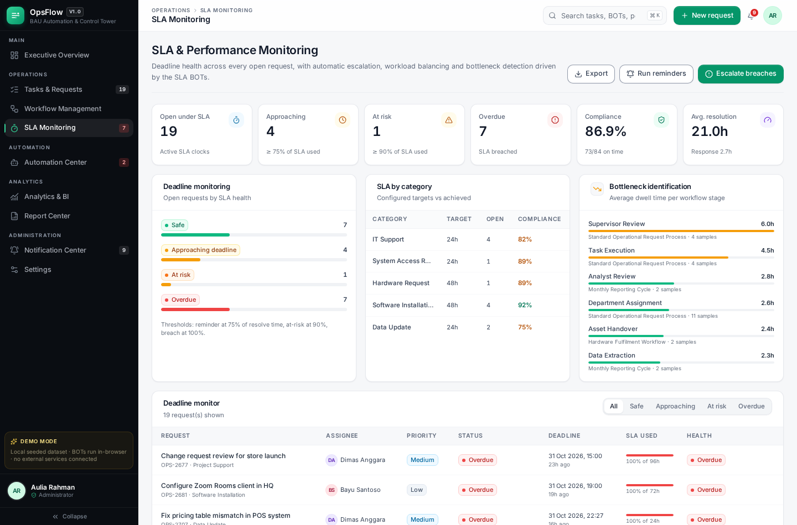
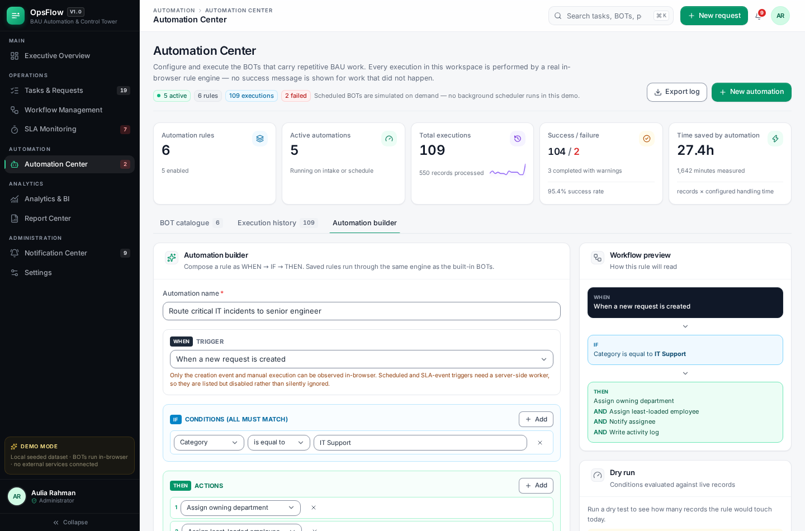
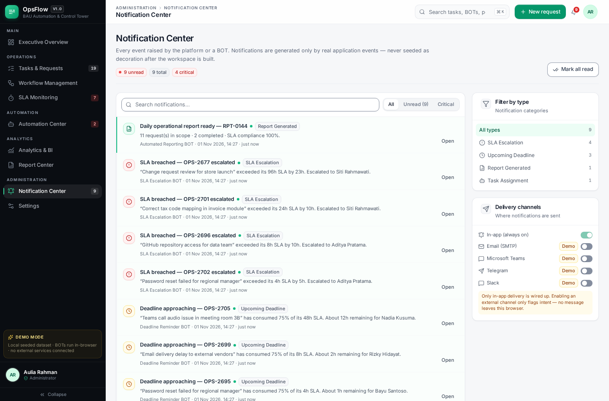
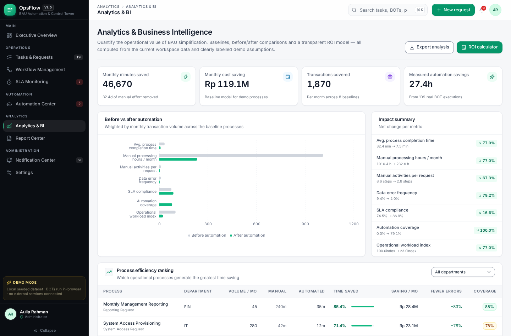
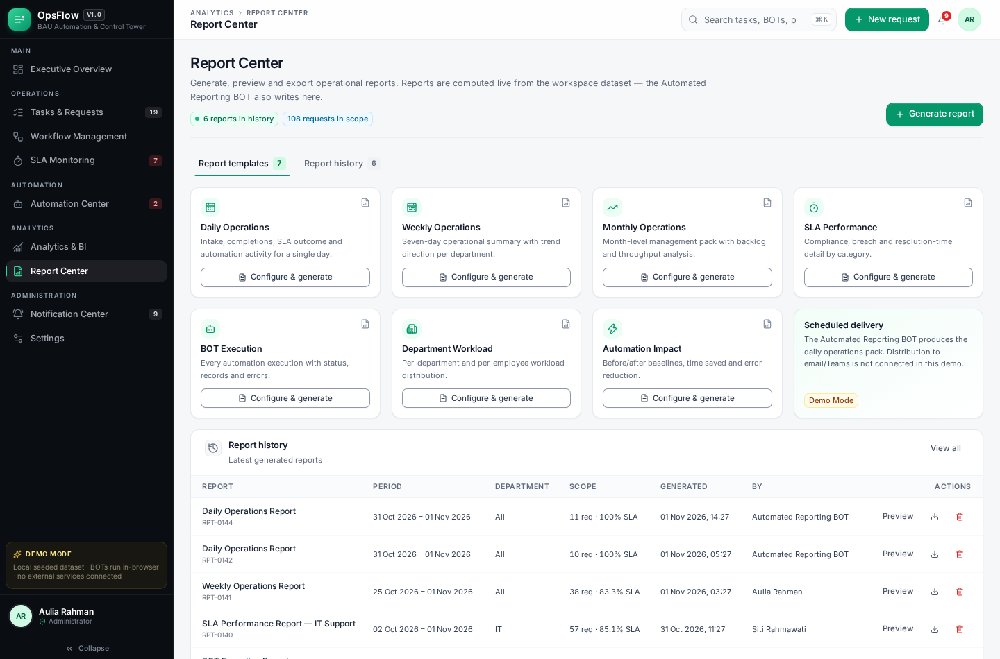

# OpsFlow — Intelligent BAU Automation & Control Tower

**Less Manual Work. More Operational Intelligence.**

OpsFlow is a premium, standalone enterprise demo of an operational automation platform. It shows
how an organisation can simplify Business As Usual (BAU) work through configurable BOTs, a central
task and SLA control tower, visual workflows, and business-impact analytics.

Everything you see is driven by one seeded dataset held in your browser, and the automation engine
is real: running a BOT mutates tasks, writes execution records, raises notifications and appends
audit activity. **No success message is displayed for work that did not actually happen.**



---

## 1. Quick start

```bash
cd opsflow
npm install
npm run dev          # http://localhost:5173
```

Other scripts:

```bash
npm run build             # type-check + production bundle into dist/
npm run preview           # serve the production build
npm run lint              # oxlint

# verification suites (need the dev server running on :5173)
npm run test:smoke         # 9 routes: renders, no console errors
npm run test:e2e           # 27 acceptance checks (demo scenario, BOTs, create, filters, export, report, mobile)
npm run test:e2e:extended  # 9 checks (roles, workflow edit, SLA policy, bulk actions, JSON export, reset)
npm run test:qa            # 9 routes × 5 viewports: overflow, dead buttons, console errors
npm run test:a11y          # 30 accessibility checks: names, keyboard, focus trap, contrast, reduced motion
npm run test:filters       # URL-backed filters survive reload and deep-link
npm run test:demo          # the demo scenario is idempotent
npm run test:readme-shots  # regenerate every screenshot embedded in this README

npm run verify             # everything above, in order, plus type-check and lint
```

`npm run verify` is the single gate for a demo-ready build. Requirement-by-requirement detail,
including the defects this final pass fixed and the tests that now guard them, is in
[`docs/HARDENING.md`](docs/HARDENING.md).

Requirements: Node 20+. No database, API key or external account is required — copy `.env.example`
to `.env` only if you are wiring a real backend later.



| | |
| --- | --- |
|  |  |
|  |  |
|  |  |
|  |  |

More: `docs/screens/analytics-workload.png`, `docs/screens/settings.png`, `docs/screens/new-request.png`,
`docs/screens/execution-detail.png`, `docs/screens/mobile-dashboard.png`, `docs/screens/mobile-tasks.png`.

Every image is captured from the running app by `node scripts/readme-shots.cjs` — no mockups.

---

## 2. What is real vs. simulated

Being precise about this is part of the product.

| Capability | Status |
| --- | --- |
| Task CRUD, assignment, status changes, comments, bulk actions | **Real** — mutates the workspace |
| SLA clocks, health classification, breach detection | **Real** — computed from task timestamps |
| 6 BOTs (validation, assignment, reminder, escalation, reporting, duplicate detection) | **Real in-browser rule engine** — trigger → condition → action |
| Execution history, error handling, failure injection | **Real** — including a *Simulate failure* path |
| Notification center | **Real** — generated by application events only |
| Workflow instances and stage progression | **Real** — advanced by BOT runs and task status |
| Analytics, ROI model, before/after baselines, efficiency ranking | **Real calculations** over demo data |
| CSV export, report generation and history, JSON workspace export/import | **Real** |
| Persistence | localStorage in this browser |
| Scheduled BOT runs | **Simulated** — executed on demand, no background worker |
| Email / Teams / Slack / Telegram / Sheets / Forms / Excel | **Not connected** — shown honestly with status labels |
| PDF export | Uses the browser print dialog (no PDF library bundled) |
| Authentication & server-side authorization | **Not implemented** — see §7 |

Demo organisation: *Nusantara Retail Group*. All names, people and metrics are synthetic and make no
claim about any real company.

---

## 3. The demonstration scenario (acceptance requirement)

**Trigger it** from the Executive Overview → *Run demo scenario*, or from the call-to-action card at
the bottom of the dashboard.

What happens, in order, each step being genuine application work:

1. A new **IT Support** request is created via the *Google Form* channel
   (“VPN access failing for the new finance analyst”, High priority, tagged `demo-scenario`).
2. The **Data Validation BOT** runs scoped to that record: mandatory fields, email format and
   duplicate similarity are checked.
3. The **Smart Assignment BOT** resolves the owning department (IT Support) and assigns the
   least-loaded available staff member; a task-assignment notification is raised.
4. A **workflow instance** is created on *Standard Operational Request Process* and advances through
   *Request Submitted → Data Validation → Department Assignment*, then to *Task Execution*.
5. The assignee's queue updates and the task enters **In Progress**.
6. The **SLA clock** for the new task is registered and appears in SLA Monitoring (Safe bucket).
7. The **Deadline Reminder BOT** will notify the assignee once the task crosses the reminder
   threshold (configurable, default 75% of the SLA window).
8. The **SLA Escalation BOT** marks breaches Overdue, notifies the operations manager and writes an
   audit record.
9. Marking the task **Completed** closes the workflow instance and updates dashboard KPIs.
10. Analytics reflects the additional throughput and the measured automation time saved.

The UI navigates straight to the new task so you can watch the timeline, workflow strip and
notification trail populate.

**Other things worth clicking**

- **Automation Center → any BOT → ⋯ → Simulate failure**: watch an execution be recorded as *Failed*,
  with no records committed, and an *Automation Failure* notification raised.
- **Tasks → New request → Create & run BOTs**: the same intake automation on your own request.
- **Task drawer → Automation tab**: run a BOT scoped to a single record.
- **Automation Center → Automation builder**: compose WHEN → IF → THEN, dry-run it against live data,
  then save and execute it.
- **Analytics → ROI calculator**: every input recomputes immediately and division-by-zero is guarded.
- **Profile menu → Switch demo persona**: demonstrates the role model (Administrator / Operations
  Manager / Staff).

---

## 4. Architecture

```
src/
├── types/index.ts             # Domain model — mirrors the documented DB schema
├── data/seed.ts               # Seeded demo dataset (tasks, users, rules, workflows, baselines)
├── services/
│   ├── automationEngine.ts    # Rule engine: triggers, conditions, 6 BOT implementations,
│   │                          # execution records, error handling, workflow sync
│   ├── analytics.ts           # Derived KPIs, trends, SLA maths, ROI, baselines, bottlenecks
│   ├── seedRuntime.ts         # Replays scheduled BOTs on first load (honest state bootstrapping)
│   └── store.tsx              # React context store + use cases; the only write path
├── components/
│   ├── ui/                    # Design-system primitives (button, badge, modal, drawer, table…)
│   ├── layout/                # Sidebar, topbar, shell, navigation model
│   ├── charts/                # Recharts wrappers with a shared tooltip and palette
│   ├── shared/                # Page headers, KPI cards, status/priority/health badges
│   └── tasks/                 # Quick-create modal, task detail drawer
├── pages/                     # One module per route
└── lib/                       # Formatting, CSV, dates, cn(), catalogs, demo org constants
```

**Layering rules**

- UI components never mutate state directly; they call store actions.
- Business logic lives in `services/` (`automationEngine`, `analytics`) and is pure where possible:
  `runAutomation(state, ruleId, opts)` returns a **new** state, never mutating its input.
- The store is the single commit point. `runRule` reads from a live state ref so back-to-back BOT
  executions build on each other instead of overwriting recent changes.
- Charts, KPIs and tables derive from state through `analytics.ts`, so numbers can never drift from
  the records shown elsewhere.

### Automation engine contract

```
runAutomation(state, ruleId, { mode, scopeTaskIds, injectFault }) → { state, execution, rule }
```

Each run produces an execution record with id, automation name, trigger, start/end time, duration,
status (`Success` / `Partial` / `Failed`), records processed, result summary, error detail, affected
task ids and metrics (assigned, validated, flagged, reminded, escalated, duplicates, minutes saved).
Failures are caught before commit and never leave partial writes. Notification de-duplication is
performed with a run-scoped key set, so re-running a BOT cannot spam duplicates.

---

## 5. Demo data

Seeded once, then owned by your browser:

- ~110 operational requests across 45 days, with realistic status ageing
- 5 departments, 15 employees (Administrator / Operations Manager / Staff) with availability
- 6 automation rules with 14 days of execution history (including two deliberate failures)
- 5 workflow definitions with live instances
- 30+ notifications, 50+ activity records, 5 report records, 8 process baselines

Reset any time from **Settings → Workspace data → Reset demo data** (or the profile menu). Export and
re-import the whole workspace as JSON from the same panel.

---

## 6. Routes

| Route | Module |
| --- | --- |
| `/dashboard` | Executive Overview — KPIs, trends, operational health, priority attention, recent activity, automation performance |
| `/tasks` | Task & request management — table + kanban, advanced filters, bulk actions, detail drawer |
| `/automation` | Automation Center — BOT catalogue, execution history, rule configuration, automation builder |
| `/workflows` | Workflow management — visual stages, instances, editor |
| `/sla` | SLA & performance monitoring — deadline buckets, escalations, workload, bottlenecks, SLA policy |
| `/analytics` | Analytics & BI — before/after, efficiency ranking, BOT value, ROI calculator |
| `/reports` | Report Center — 7 report types, preview, CSV export, history |
| `/notifications` | Notification center — type filters, read state, deep links to the source record |
| `/settings` | Administration — organization, users, roles, SLA config, integrations, workspace data |

---

## 7. Limitations and the path to production

This is a **demonstration build**, not a production system. Deliberately absent:

- **Authentication and server-side authorization.** Role checks are UI-only and trivially bypassable
  in a browser. Production needs a real identity provider, signed sessions and server-enforced
  authorization (e.g. Postgres row-level security).
- **A backend and database.** State lives in localStorage; there are no APIs, no multi-tenancy, no
  concurrency control and no audit immutability.
- **Background scheduling.** BOTs run when triggered. Production would move the engine to a worker
  (cron/queue) with idempotency keys and retry/backoff.
- **External integrations.** Email, Microsoft Teams, Slack, Telegram and Google Sheets/Forms are
  displayed with their true status (Not Connected / Demo Mode / Configuration Required). Wiring them
  requires server-side credentials — see `.env.example`. **Never** put secrets in a frontend bundle.
- **PDF generation.** Use the browser print dialog; a server-side renderer (e.g. Puppeteer or a
  reporting service) would be the production approach.

Migration path: keep the domain types, swap `services/store.tsx` for an API client, move
`automationEngine.ts` into a worker, and keep `analytics.ts` shared between client and server.

---

## 8. Security posture

Implemented in this build: input validation on all forms, text sanitisation before persistence,
destructive actions behind confirmation, no secrets in the bundle, no external network calls, honest
disclosure of simulated capability.

Not implemented (and required for production): authentication, server authorization, transport and
at-rest encryption, rate limiting, audit immutability, dependency and infrastructure hardening.
Do not describe this demo as enterprise-secure.

---

## 9. Tech stack

React 19 · TypeScript · Vite · Tailwind CSS · Recharts · React Router · Lucide icons · Inter
(via `@fontsource-variable/inter`, bundled locally so no CDN is required) · browser `localStorage`
persistence behind a service layer.

---

## 10. Design system

The interface is built on one small vocabulary rather than per-page styling:

- **Tokens** (`tailwind.config.js`, `src/index.css`) — a 12-step type scale, 4px spacing grid,
  five shadow tiers (`xs → card → raised → pop → drawer`), one easing curve (`ease-smooth`),
  and named animations (`fade-in`, `slide-up`, `page-in`, `toast-bar`) so every transition in the
  product feels like it came from the same hand.
- **Primitives** (`src/components/ui`) — Button, Badge, Card, Field/Input/Select, Switch, Tooltip,
  Modal, ConfirmDialog, Drawer, Dropdown, Segmented, Tabs, Avatar, Progress, Pagination, SortHeader,
  ToastHost. Pages compose these instead of re-inventing controls, which is what keeps density,
  radius and focus states identical across nine modules.
- **Patterns** — eyebrow-labelled metric bands instead of KPI walls; one affordance per table row
  (clickable row + hover kebab/chevron); sticky blurred table heads; a colour-coded `WHEN / IF / THEN`
  sentence strip for automation rules; a left accent rail on stateful cards; number rails built with
  `divide-x` on a tinted surface; process pipelines that fill the available width at any viewport.
- **Charts** — hairline grids, frameless axes, tabular-numeral ticks, shared `STATUS_COLORS`, and a
  legend on every plot that uses more than one series.
- **Accessibility** — every interactive element is a real `button`/`a` with an accessible name,
  overlays trap focus and close on `Escape`, and unread/overdue state is signalled by an icon or dot
  as well as by colour. The QA suite fails the build on buttons with no handler and on console errors.

Layout is verified rather than assumed: `test:qa` asserts **zero horizontal page overflow across nine
routes at 390 / 768 / 1024 / 1440 / 1920px**, which is why wide tables scroll inside their own card
instead of dragging the page sideways.

The full before/after rationale — including the one line of CSS that fixed a 514px mobile overflow
caused by sticky table headers — is in [`docs/UI-REFINEMENT.md`](docs/UI-REFINEMENT.md).

---

## 11. Deploying

A static SPA with no backend — `vercel.json` is included and the deep-link rewrite that keeps the
nine routes working on a hard refresh is already configured. See
[`docs/DEPLOY-VERCEL.md`](docs/DEPLOY-VERCEL.md) for the settings, the one non-obvious build flag
(Playwright must not download browsers on the builder) and what changes about state once the app
is served from a real origin.

```bash
npm run build && npx vite preview --port 4173
npm run test:prod          # 9 routes + hard refresh on a ?task= deep link, production build
npx vercel --prod
```

## 12. Business validation report

`docs/OpsFlow-Business-Case.docx` is a management-grade business case for implementing the
platform, written from the application's own data: 108 requests, 109 BOT executions, 8 process
baselines and the ROI input set. It covers the operational problems addressed, an AS-IS/TO-BE
process comparison, manual activities removed or reduced, automation coverage, time savings,
error and SLA opportunities, ROI assumptions, implementation risks, prototype limitations,
recommended production integrations and quantitative acceptance criteria.

Every claim is graded **Measured** / **Projection** / **Simulated**, and the report is
regenerated from the live workspace rather than hand-written:

```bash
npm run case:all     # export state → charts → .docx   (dev server running)
```

Supporting notes, the derivation of every headline number and the record of corrected input
inconsistencies are in [`docs/business-case/README.md`](docs/business-case/README.md).
A browser-readable copy of the report is at `docs/business-case-report.html`.
